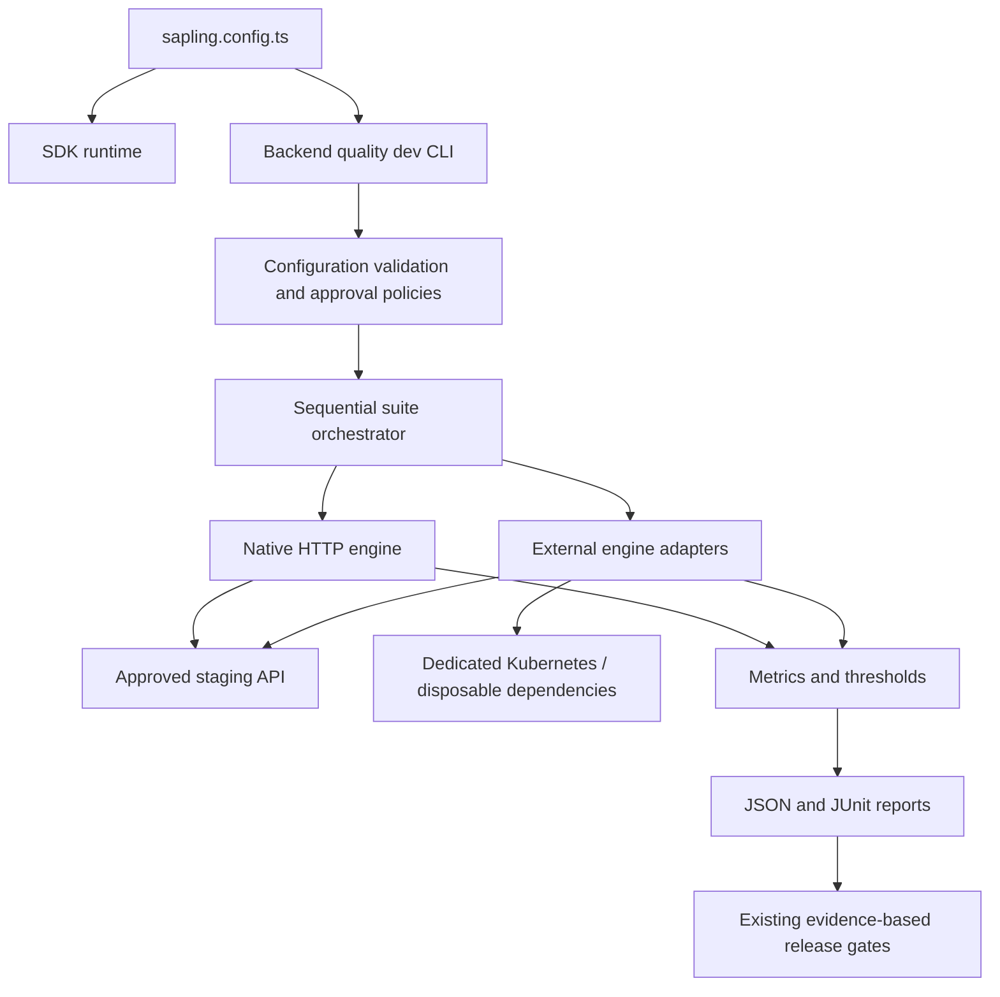

> v0.6.0 integration update: see [QUALITY_INTEGRATION.md](QUALITY_INTEGRATION.md) for current full-stack configuration, packages, commands and parity. Earlier SDK sections are retained for context.

# Backend quality HLD / LLD

`core/config.ts` validates typed config, target scope, suite IDs, category compatibility and limits. `core/runner.ts` executes selected suites serially, captures status and durations, and never marks disabled/missing engines as passing. `engines/native.ts` executes bounded concurrent GET probes and evaluates statuses. `engines/process.ts` uses argument-array subprocesses, timeout, output caps and process-group termination. `engines/external.ts` adapts approved engine CLIs and operator-authored tests. `core/results.ts` calculates nearest-rank percentiles and checks thresholds. `reporters/index.ts` writes JSON and escaped JUnit. `cli.ts` reads the shared config, selects suite/category, writes reports and exits nonzero on failures. SDK has no dependency on quality. External engine execution and orchestration are not equivalent to engine-specific deep validation. No automated scheduling from production middleware.
