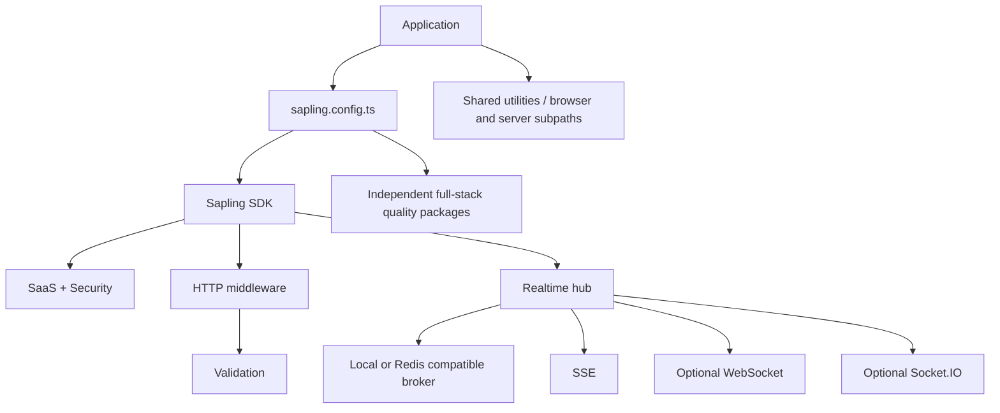

> **v0.10.0:** See [flat SDK, hooks and pnpm migration](technical-specifications/ENGINEERING_0100.md) for the current API, workspace and verification. Historical sections below may describe older releases.

> v0.8.0 update: see [technical specifications](technical-specifications/README.md) for current contracts, validation migration, recurring billing, offboarding, acceptance criteria and release blockers. Historical descriptions below may describe prior releases.

# Sapling v0.7.0 — Foundation packages

## Scope and design decisions

The SDK v0.6.0 monorepo is the base; all 182 SaaS mappings, 41 scanner categories, defender, 16 backend and 16 frontend quality suites are retained. Four independently installable runtime packages are added. The original toolkit is consolidated, not reimplemented from scratch. The package scope remains `@sapling` except for `@saplings/validations`, which uses the exact requested name. The latter is an independent implementation inspired by Zod's API, not Zod itself or a drop-in compatibility guarantee. All package manifests use 0.7.0. No network transport is opened implicitly.

| Package | Purpose | Dependencies |
|---|---|---|
| `@sapling/utils` | Shared browser/server utilities | Native APIs only; Node-only helpers via `/server` |
| `@saplings/validations` | Typed runtime parsing and validation | None |
| `@sapling/realtime` | Tenant-aware realtime hub | Native Node; optional `ws` and `socket.io`, injected Redis/Valkey client |
| `@sapling/middleware` | Express-compatible HTTP utilities | Validation types; optional `compression` and `multer` |
| `@sapling/sdk` | Existing SDK and composition | New middleware/realtime packages; no quality engines |



## Utilities

`es-toolkit-expanded.zip` from the user's Library is the authoritative input. All ten original modules are present under `packages/utils/src/`. Original README is retained. See `UTILITIES_SOURCE_PARITY.json` for original/current hashes and `UTILITIES_CATALOG.md` for exported names. The original clone archive is an earlier version; no duplicate copy of its overlapping functions is introduced. Changes to imported files: TypeScript narrowing and iterator types, unsafe object path rejection, own-property checks, debounce flush arguments and abort listener cleanup, cookie decoding/removal fixes, policy path own-property resolution. `id.ts` adds native CSPRNG `nanoid`; it is not the npm nanoid package. The original hooks module is framework-agnostic, not a React hook library. The original permissions module is a policy helper; server-side Sapling SDK access checks remain authoritative. Original date behavior uses native Date/Intl; DST/calendar correctness depends on the specific function and timezone. No secret storage in localStorage or client-readable cookies.

```ts
import { chunk, nanoid, date, storage, permissions } from '@sapling/utils';
import { sha256, collectStream } from '@sapling/utils/server';
import { map } from '@sapling/utils/fp';
const ids = chunk([nanoid(), nanoid()], 1);
const prefs = storage.localStore({ namespace: 'my-app' });
// Only in a browser; never store tokens or secrets here.
```

Browser imports must not use `/server`. The `types` module is type-only. Browser storage works with available browser APIs; local/session storage without namespace deliberately has broad scope. Server file path helper is lexical only and does not prevent symlink traversal; restrict paths and use OS isolation. Never use `randomInt`, `shuffle`, etc. for secrets. Prefer `nanoid` or native cryptography.

## Validation

```ts
import { z, ValidationError } from '@saplings/validations';
const User = z.object({
  email: z.string().trim().email(),
  age: z.coerce.number().int().min(18),
  role: z.enum(['admin', 'member']).default('member'),
  nickname: z.string().optional()
}).strict();
type User = z.infer<typeof User>;
type UserInput = z.input<typeof User>;
const result = User.safeParse({ email: 'person@example.com', age: '30' });
if (result.success) console.log(result.data);
else console.log(result.error.flatten());
const asyncSchema = z.string().refine(async value => value.length > 3);
await asyncSchema.parseAsync('valid');
```

Supported: primitive schemas, literal, string enum, arrays/tuples/objects/records/maps/sets, union/intersection, discriminated union with synchronous discriminator schemas, recursive lazy, coercion and preprocess, optional/nullable/default/catch, refine/superRefine, transform/pipe, object pick/omit/partial/extend/merge and strip/strict/passthrough; issue paths, safeParse and async equivalents; input/output inference. Finite number/safe integer checks; bounded complexity (depth 64, 10,000 collection entries, 100,000 parser steps, up to 100 issues); unsafe object keys rejected. Coercion deliberately differs from Zod: `false` string coerces to false, empty string is not a number, unsafe inputs are rejected. URL validation checks syntax, not SSRF or HTTP scheme. User refinements can throw and may be asynchronous; exceptions from user code are not swallowed. Do not run untrusted regular expressions/refinements. `passthrough` preserves unknown values and is not a deep sanitizer. Not implemented: complete Zod method/issue/format parity, Zod internals, JSON Schema/OpenAPI generation, native enum/brand/function APIs and full ecosystem compatibility. Use Zod if exact compatibility is required.

## SDK configuration and middleware integration

```ts
import { defineSaplingConfig } from '@sapling/sdk';
export default defineSaplingConfig({
  app: { id: 'my-saas', environment: 'development' },
  middleware: {
    correlationId: true,
    requestLogging: true,
    log: event => console.log(event),
    // timeoutMs: 5000 // enable per normal request; do not apply to SSE
  },
  realtime: { enabled: false },
  // existing auth, storage, billing, quality, etc.
});
```

```ts
import express from 'express';
import { createSapling } from '@sapling/sdk';
import { validate, requireAuth, authorize, requestTimeout } from '@sapling/middleware';
import { z } from '@saplings/validations/native';
import config from './sapling.config.js';
const app = express();
const sdk = createSapling(config);
app.use(sdk.defender.preflight());
app.use(express.json({ limit: '100kb' }));
app.use(sdk.middleware()); // authenticated tenant context and defender
app.use(...sdk.httpMiddleware());
app.post('/projects', requireAuth(), requestTimeout(5000),
  validate({ body: z.object({ name: z.string().min(1).max(100) }) }),
  authorize(async req => {
    await sdk.authorize({tenantId:req.sapling!.tenantId!,actorId:req.sapling!.userId!,roles:req.sapling!.roles,permissions:req.sapling!.permissions}, 'projects:create');
    return true;
  }), (req, res) => res.json({ data: req.validated?.body }));
app.use(sdk.httpErrorHandler());
```

The example returns validated input for demonstration only. Replace with actual business operations. Add Express declaration merging for custom `req` fields if directly referencing them from typed route handlers. `sdk.httpMiddleware()` is explicit to keep old framework-neutral middleware behavior intact. Validation writes to `req.validated` instead of mutating Express 5 read-only query fields. Generic middleware includes correlation ID, request logger (no query/body/header secrets), timeout, trusted-context auth, permissions, custom authorization, validation, content-type and content-length guard, async wrapper, 404, error envelope, public JSON cache, idempotent JSON handler, optional compression and multipart. Continue using existing defender for CORS, CSRF, rate limiting, threat detection, IP rules and security headers; no duplicated security pipeline. The content-length guard is not a streaming size limiter: use a bounded parser and proxy limit. `errorHandler` masks unknown error details and passes through already-started responses. `requestTimeout` aborts a signal and sends 504 but cannot roll back a handler that ignores cancellation. Do not install deadlines on SSE; configure route-level timeouts.

`publicJsonCache` caches explicitly public anonymous GETs, and refuses auth/cookies. It is application-level caching, not HTTP CDN caching. Use a bounded store with explicit vary keys, separate stores per application/environment. `idempotentJson` scopes to tenant, user, operation and key; detects conflicts, blocks in-progress duplicates and replays completed results. Use `TenantIdempotencyStore` with the SDK's transaction-capable store for persistence:

```ts
import { TenantIdempotencyStore } from '@sapling/sdk';
import { idempotentJson } from '@sapling/middleware';
const createOrder = idempotentJson(
  req => new TenantIdempotencyStore(sdk.store, req.sapling!.tenantId!),
  'orders:create', async req => ({ status: 201, body: await createOrderInApplication(req) })
);
```

`createOrderInApplication` is a placeholder for the application's transaction/outbox-aware handler. Claims are durable but handler side effects and completion are separate transactions; a crash can leave pending claims. Reconcile ambiguous requests manually; do not blindly release claims or claim exactly-once behavior. Configure retention/quotas in production. Memory cache and idempotency store are local only. File uploads use bounded memory (one file, limits) and declared MIME filtering; actual content inspection/antivirus/object storage authorization remain app duties. Do not compress secret-bearing endpoints; exclude auth and SSE, assess BREACH.

## Realtime

```ts
import { RedisBroker, attachWebSocket, attachSocketIO } from '@sapling/realtime';
// Configure independently connected node-redis compatible clients:
const broker = new RedisBroker(publisher, subscriber);
// in sapling.config.ts:
const realtime = {
  enabled: true, broker,
  allowedOrigins: ['https://app.example.com'], allowNoOrigin: false,
  maxConnections: 1000, maxSubscriptions: 16,
  maxMessageBytes: 65536, heartbeatMs: 15000, sessionTtlMs: 300000,
  authenticate: async (req, credentials) => verifyTrustedSession(req, credentials),
  authorize: async (principal, channel, action) => checkChannelPolicy(principal, channel, action)
};
// verifyTrustedSession and checkChannelPolicy are application-specific callbacks,
// never accept a tenant ID supplied by a client as authentication.
```

With `sdk.realtime` enabled, add `app.get('/events/:channel', (req,res) => void sdk.realtime!.sse(req,res,req.params.channel))`; it uses the realtime authentication and policy again. `await attachWebSocket(server,sdk.realtime!, '/ws')` and/or `await attachSocketIO(server,sdk.realtime!, '/socket.io')` require optional transports. For WS use JSON command `{type:'subscribe',channel:'updates'}`; acknowledgement `type:ack`. Socket.IO uses `sapling:subscribe` / `sapling:unsubscribe` acknowledgements and `sapling:event` notifications. SSE uses `message` events with JSON payload and periodic heartbeat. Browser native EventSource cannot set Authorization headers: use a secured cookie-based session and appropriate origin/cookie policy, or fetch streaming with verified auth. Server publishes only via `await sdk.realtime!.publish(trustedPrincipal,'updates',{...})`. No arbitrary client publishing. All subscriptions enforce tenant + channel and policy, disconnect on slow consumers or TTL. Close hub and transport during graceful shutdown. Configure reverse proxy upgrade, buffering and idle timeouts; Socket.IO polling across replicas may require sticky sessions and engine adapter; prefer WebSocket-only clients where appropriate. Broker Pub/Sub is ephemeral at-most-once, no durable replay or SSE Last-Event-ID resumption. Redis/Valkey broker has no reconnect replay. Do not use as a durable business workflow; existing SDK job/outbox/webhooks continue to serve that need. For production require a shared broker and real authentication/authorization; session TTL bounds stale grants but does not provide immediate revocation. Additional perimeter connection limits, DDoS controls, revocation and distributed scale tests required.

## Installation & tests

From source: `pnpm install && pnpm run build && pnpm run build:quality && pnpm test`. Locally the four packages, core SDK and dependency-free quality subset compile. Optional engines need installation: `pnpm add ws socket.io compression multer`, `pnpm add -D socket.io-client`, then `pnpm run test:foundation:live`. For Redis use the existing `redis` client dependency and two connected clients (publisher/subscriber). Configure actual credentials and live integration tests before production. External integration suite is supplied, not executed here. See `BUILD_VERIFICATION.md` and `GAPS_AND_IMPROVEMENTS.md`.
