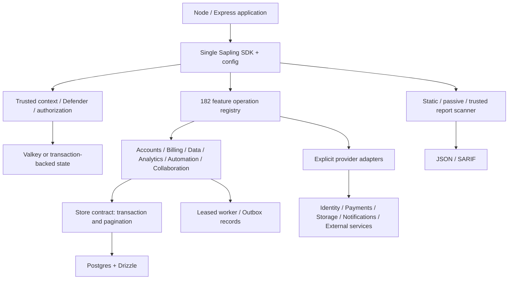

> **v0.13.0:** Two new packages (`@saplings/harbor`, `@saplings/kingsman`) and typed optional `sapling.gateway` / `sapling.identityPlatform` integrations. See [platform specs](platforms/CONFIG_COVERAGE.md) and their detailed product/technical/gap documents. Existing production gates remain open; both platforms require real infrastructure/conformance testing.

> **v0.12.0 source audit:** Reviewed all 182 SaaS feature dossiers and tested shared action/permission/freeze contracts. See [feature gap audit](technical-specifications/SAAS_GAP_CLOSURE_012.md). Prior sections can describe older releases; do not infer production readiness.

> **v0.11.0 update:** Cashfree is the preferred payment gateway. See [Cashfree payments](technical-specifications/CASHFREE_PAYMENTS.md) and [feature dossiers](features/README.md). Historical sections below may describe previous releases.

> **v0.10.0:** See [flat SDK, hooks and pnpm migration](technical-specifications/ENGINEERING_0100.md) for the current API, workspace and verification. Historical sections below may describe older releases.

> v0.8.0 update: see [technical specifications](technical-specifications/README.md) for current contracts, validation migration, recurring billing, offboarding, acceptance criteria and release blockers. Historical descriptions below may describe prior releases.

> v0.7.0 foundation update: see [FOUNDATION_PACKAGES.md](FOUNDATION_PACKAGES.md) for new packages, configuration, usage and limitations. Existing sections are retained as the baseline.

> v0.6.0 integration update: see [QUALITY_INTEGRATION.md](QUALITY_INTEGRATION.md) for current full-stack configuration, packages, commands and parity. Earlier SDK sections are retained for context.

# High-level design — v0.3

SDK remains an in-process library; do not treat it as a deployed cloud control plane. Separate API and worker processes and reuse the same configuration. PostgreSQL is a shared state dependency. Valkey limits burst load on DB. Optional provider adapters isolate external service credentials and calls. Use application-specific domain schemas and resource-level access control, not only generic records. Generic store page uses ordered ID cursor; legacy list and reference analytics still use collection reads. Split high-volume analytics, search, queue and audit storage into dedicated providers as scale grows.

## v0.3 release additions

See [provider matrix](PROVIDER_MATRIX.md), [test plan](TEST_PLAN.md), and [release gates](GAPS_AND_IMPROVEMENTS.md) for current implementation, validation and limitations.

## v0.9.0 additions
See [engineering assessment and APIs](technical-specifications/ENGINEERING_090.md) for provider workflows, domain policies, retention, Stripe reconciliation, realtime ACK and quotas.
