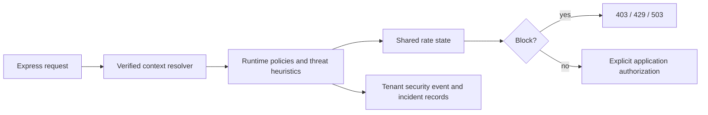

# Security design — v0.3

## Scanner

Original 41 category IDs preserved. Static and passive HTTP checks map to 38 categories; configured DNS adds two categories. Built-in checks are static review signals or passive observations, not active exploit validation. The remaining report-only category requires trusted evidence; all categories accept evidence adapters. `SarifReportAdapter` imports existing bounded CI reports; it does not run external commands. Scanner records evaluated checks, executed, not executed and failed categories. A no-finding result is not a secure result. Source excerpts withheld; no credentials in findings. Configure owned hostname allowlist; no redirects, explicit timeouts, no active attack payloads. Run from a restricted CI worker with fixed source root; use egress controls, private network protection and least privilege.

## Runtime defender

Exact IP allow/deny, explicit origin, optional cookie CSRF with session-bound verifier and origin checks, verified TLS callback, framing/content length, headers, rate limits by IP and verified identity with shared state, suspicious SQL/script/traversal/metadata/NoSQL/prompt indicators. Prompt signals opt-in per route. The application must configure real proxy trust, bounded parsing, secure cookies, framework-level validation, parameterized DB operations and per-resource authorization. Do not rely on pattern matching as primary injection protection. Monitor mode allows heuristic matches, but explicit policy violations still block. Middleware does not bypass policy for excluded paths; old evaluate() exclusion applies only to legacy synchronous evaluation. Rate state failure defaults to block (503); alert sink failures are surfaced via configured error hook but do not themselves block traffic. Tenant events persisted with verified tenant or a reserved security tenant for unauthenticated events. StoreRateState is transaction-backed; prefer ValkeyRateState at high RPS. Configure a cleanup policy for security state and events. Bot/device fingerprinting, SIEM, audit retention and independent tamper evidence and edge DDoS protection still need work.

## v0.3 release additions

See [provider matrix](PROVIDER_MATRIX.md), [test plan](TEST_PLAN.md), and [release gates](GAPS_AND_IMPROVEMENTS.md) for current implementation, validation and limitations.
