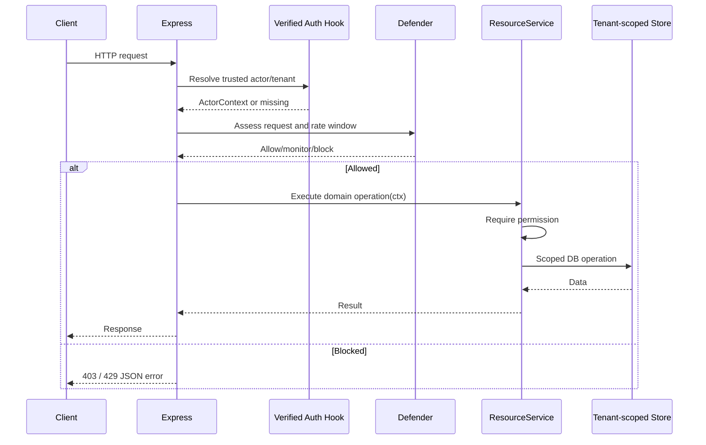

# LLD — internal contracts and behavior

## Service APIs and boundaries

`createSapling(config)` validates env and creates services. `ResourceService` implements tenant-scoped create/get/list/update/delete, permission checks and append-only-style audit logging through the Store interface. `IdentityService` stores SHA-256 digests of random API keys and rejects unknown/revoked/expired tenant-scoped keys. `BillingService` provides metering/quota checks with acknowledged concurrency limitations. `FlagService` uses stable SHA-256 bucketing; `JobService` provides enqueue/workNext/retry/dead states with no durable worker leases.

## Request sequence

## Scanner engine

- `runScan({ root, url?, allowedHosts? })` inventories source files up to caps and runs targeted heuristic rules (11 rules, 10 source categories), plus passive GET on explicitly allowlisted URL (5 categories).
- Scanner marks categories not run; it does **not** report omitted categories as passing. URL checks never submit injection payloads.
- Results use stable scanner IDs, check IDs, confidence, remediation, source location, redacted evidence and optional SARIF.

## Defenses

`Defender.assess` evaluates high-confidence path probing, traversal, SQL/XSS/prompt-like inputs, known automation UAs, threshold rate window, and custom rules. In `monitor` it records without blocking; in `block` it returns 403/429 for configured high-risk signals. In-process de-duplication uses hashed offender keys; upstream proxy headers are untrusted by default.

## Production invariants still missing

Atomic quota changes, transactional outbox, durable scheduler/leases, row-level security with DB session isolation, strict audited policy evaluation, token/session lifecycle, encryption policy enforcement, threat-signal normalization, alert retention, WAF/DDOS mitigation and authentication/authorization penetration testing. None should be inferred from the existence of a facade.
