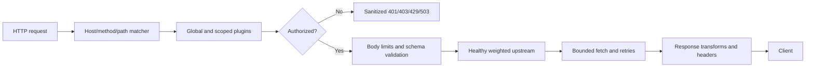

> **v0.15.0:** [Flat SDK implementation and critical-code changes](../technical-specifications/ENGINEERING_015.md) · [evidence-based production assessment](../technical-specifications/PRODUCTION_READINESS_015.md). P0/P1 items below remain open until real accepted evidence; older version claims are historical.

Gateway state adapter: `packages/harbor/src/state.ts` (durable atomic `GatewayTransactionalRateLimitStore`, `GatewayTransactionalBanStore`, `GatewayStateMaintenance`). Quota keys separate the identity/limit/window dimensions; an actual Redis/Valkey driver and production verification remain external. `key-auth` is supported by code, but is not present among the 14 plugins in the uploaded sample. Production trusted-proxy TLS is verified per request.

# Sapling API Gateway — Technical Specification v0.13.0

## Package
`@saplings/harbor` — independent Node 22 TypeScript workspace with `Gateway`, `validateGatewayConfig`, `loadGatewayConfig`, `MemoryRateLimitStore` and structural adapter types.

## Source configuration
- Full: `examples/platform/GatewayConfig.json` (original upload, unchanged).
- Minimal: `examples/platform/GatewayConfig.yaml` (original upload, unchanged; `yaml` parser dependency required at runtime).
- `apiVersion: gateway.sapling.dev/v1alpha1`, `kind: GatewayConfig`, metadata and `spec` are validated. Configuration does not automatically start a listener.

## Request execution


**Router:** Longest prefix first, exact route by default, path-prefix with segment boundary, method and optional host, path strip and service base. HTTP/1.1 with Node HTTP server; `Gateway.listen()` defaults to loopback and requires trusted TLS ingress flag in production; `Gateway.listenTls()` loads configured PEM certificates using injected secret resolver and enforces SNI. Request host cannot control upstream host. Upstream targets are strictly from validated configuration; optionally enforce `allowedUpstreamHosts` as an exact allowlist. Explicit `trustProxy` requires trusted CIDR matching before using forwarded IP, and inbound `x-sapling-*` identity headers are scrubbed.

**Balancer:** Weighted round robin, weighted least active connections, configurable active probe and passive breaker; explicit `startHealthChecks()` and `close()` lifecycle. Retries only GET/HEAD/OPTIONS, bounded by configured `retries`. Upstream reads are capped at 4 MiB and requests at the scoped body limit. This uses buffered bodies, not large-file streaming. No transparent automatic service discovery.

**Plugin precedence:** global → consumer-group → consumer → service → route; latter matching names override the earlier configuration. Applied security phase order: correlation → CORS → IP/geo/bot/DDOS → JWT → ACL → quotas → body size/schema → cache/transform/logging. Disabled route plugins can disable inherited plugins, so configuration changes require privileged review. Per-request actor/tenant from `verifyJwt`; the default identity adapter verifies realm/audience and RS256 via `sapling.identityPlatform`.

**Supported in-process controls:** correlation ID, exact-origin CORS with preflight, bearer JWT verifier adapter, role ACL, request size/header budget, trusted-schema callback, basic IP CIDR and threat-feed adapter, geo lookup callback, user-agent deny patterns, bounded token buckets, DDOS rate thresholds, response JSON remove/mask/headers, authenticated authorization-partitioned GET cache, logging override marker, upstream probe, circuit breaker, deprecation headers. Basic memory limiter is for testing only; production requires shared external `RateLimitStore` for configured quotas. Caching is process-local, limited to 500 entries and 256 KiB per response; no cross-node cache invalidation.

**External/config-only:** certificates via external vault resolver; geo and threat feeds via verified callback; actual challenge/ban bot/DDOS behavior, DNS/proxy trust enforcement across external layers, geo dataset, Loki/Mongo/SIEM/file logging sinks, trace exporter and HA/Redis limiter adapter require implementation and live integration. The current `onEvent` callback is the sole implemented observability sink interface. Refer to `docs/platforms/CONFIG_COVERAGE.md` for exact field mapping.

## Public SDK integration
```ts
import {createSapling} from '@saplings/sdk';
import {loadGatewayConfig,MemoryRateLimitStore} from '@saplings/harbor';
const cfg=await loadGatewayConfig('examples/platform/GatewayConfig.json');
const sapling=createSapling({app:{id:'school',environment:'development'},platforms:{gateway:{config:cfg,dependencies:{rateLimit:new MemoryRateLimitStore(),verifyJwt:yourVerifier,threatIp:yourVerifiedFeed}}}});
const port=await sapling.gateway!.listen(); // loopback development only
```

The full source configuration's `metadata.environment` is `production`. For actual production, inject a durable distributed limiter, trusted TLS secrets and (if using built-in realm verifier) the identity runtime; do not edit status or switch metadata to development on a live deployment. An in-process `Gateway` is not equivalent to a globally available Kubernetes ingress without independent deployment, resource budgets and network policies.

## Security and deployment
Do not accept client-controlled proxy headers from the public Internet; trusted ingress must overwrite/remove them. Require TLS, resource ceilings, body/response bounds, pinned upstream hosts, narrowly scoped secret resolvers, redacted events and explicit live tests. Use a reviewed lockfile (`pnpm install --frozen-lockfile`), `pnpm run build:platforms`, and `pnpm run test:platforms`. Gateway bind/listen runs only when the host explicitly invokes it. No networking starts at SDK construction.
