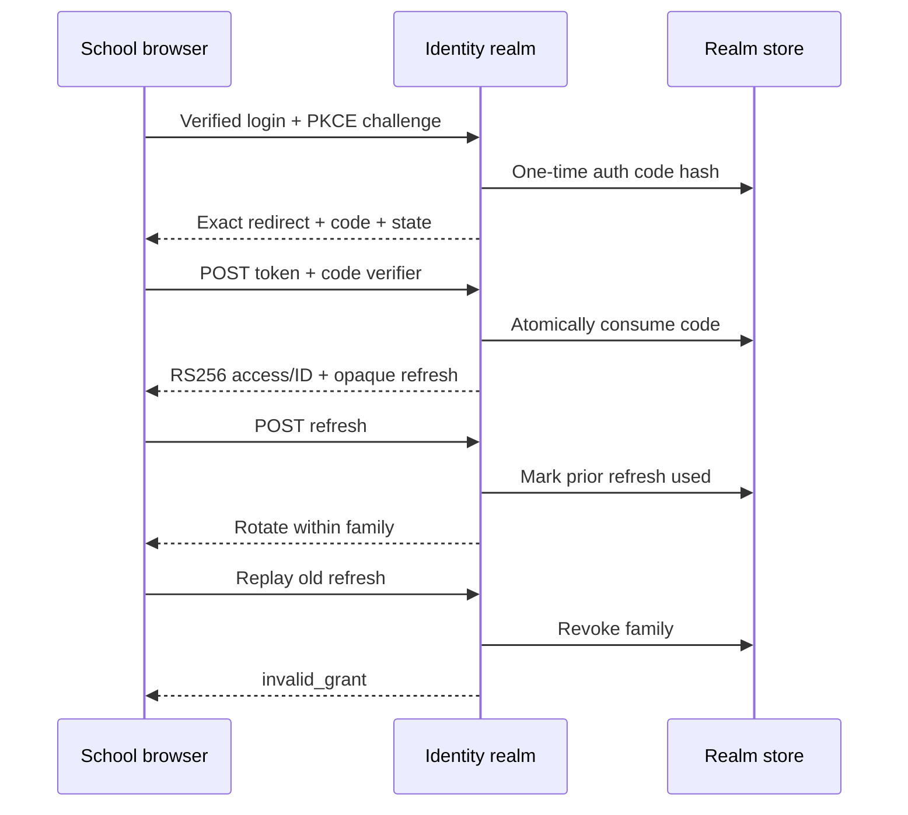

> **v0.15.0:** [Flat SDK implementation and critical-code changes](../technical-specifications/ENGINEERING_015.md) · [evidence-based production assessment](../technical-specifications/PRODUCTION_READINESS_015.md). P0/P1 items below remain open until real accepted evidence; older version claims are historical.

Token introspection/revocation handlers under OIDC path are implemented; revocation/replay enforced in the realm session verification. They have local tests only; do not infer external protocol certification.

# Sapling Multi-Tenant Identity — Technical Specification v0.13.0

## Package and source
`@saplings/kingsman`; `examples/platform/RealmConfig-full.json` is a verbatim copy of the uploaded full realm JSON. Source declares `apiVersion: identity.sapling.dev/v1alpha1`, `kind: RealmConfig`, metadata, complete spec and informational status. Runtime validates active RS256 issuer, client redirect/grant/PKCE, refresh reuse and password Argon2id policy. Unknown optional properties are preserved as configuration, **not silently executed**. The uploaded `status.phase: Ready` is a dated snapshot and does not indicate this implementation's health.

## Public interfaces
`new IdentityPlatform(realm,dependencies)` provides `registerUser`, `verifyEmail`, `requestPasswordReset`, `resetPassword`, `authenticatePassword`, `sessionUser`, `revokeSession`, `authorizeCode`, `exchangeCode`, `refresh`, `clientCredentials`, `verifyAccessToken`, `configureTotp` (dev only), `createOrganization`, `inviteOrganization`, `acceptInvitation`, `discovery`, `jwks`. `MemoryIdentityStore` exists for local testing; production must inject a durable transactional identity store. Store remains realm-scoped, with separate users, credentials, sessions, actions, auth-codes, refresh-families and organizations.

**Cryptography:** RS256 with Node's RSA-SHA256 and a non-exported private key object, stable public JWK `kid` derived from public key when not supplied. **Production requires injected persisted RSA 2048+ key pair**; development generates ephemeral keys (invalid after process restart). Argon2id is an externally injected `RealmPasswordHasher` rather than a weaker silent fallback; breached-password check and email delivery must also be injected when required. TOTP uses SHA256/6 digits/30s and the configured role-conditional flow; production plaintext TOTP enrollment is denied without an encrypted storage adapter. Client secrets are resolved at use by vault resolver; never embedded directly in compiled config.

**OAuth/OIDC:** GET `/<realm>/.well-known/openid-configuration`, GET `/protocol/openid-connect/certs`, GET `/protocol/openid-connect/auth` (host must supply verified browser session), POST `/protocol/openid-connect/token` form-encoded for auth-code/refresh/client_credentials, GET `/protocol/openid-connect/userinfo`. Requires public-client PKCE S256 + state and exact registered HTTPS redirect. Auth code hash stored and consumed atomically; refresh tokens are opaque hashed records and rotating family with replay revocation. Access/ID JWT contain RS256 signatures and issuer/audience/exp/client/realm/roles/groups, optional org information. Access JWT validation rejects revoked/expired sessions. Token exchange uses transactional storage for code claim and separate issue; external issue/response loss requires operational recovery and conformance testing.

**Realm model:** Users get default realm roles and default groups (`/students`); child-group and composite realm roles are resolved at access-token issuance. Role-conditional OTP binding is interpreted from `authenticationFlows`. Organizations maintain owner/member mapping with hashed expiring invitations. The current token claim mapping only partially reflects `clientScopes` and client policy profiles; see open gaps for exact mapper support, per-organization IdP selection, role/permission administration, child organization and legacy migration.

**Cross-package SDK integration:** `createSapling({app,platforms:{identity:{config:realm,dependencies:{store,passwordHasher,signingKey,resolveSecret,sendAction,breachedPassword}},gateway:{config:gateway,dependencies}}})`. `sapling.identityPlatform` and `sapling.gateway` are optional typed properties. SDK auto-wires gateway JWT verification **only when the configured `realmRef` equals the identity realm**, with permitted RS256/audience checks. Existing `sapling.identity` remains the original SaaS account service; this new package does not automatically replace or migrate it. Host is responsible for shared user/account mapping, authoritative principals, permission translation and single sign-on/cookie security.

## Operation and deployment
Start with `pnpm install --frozen-lockfile`, `pnpm run build:platforms`, `pnpm run test:platforms`. Mount HTTP handler only behind TLS or approved TLS ingress, and supply `authenticateBrowser(req)` from a verified session cookie. Credentials, bootstrap temp passwords, email tokens and provider secrets must be kept out of logs and publicly accessible artifacts. Expose only necessary endpoints and approved redirect hosts. Maintain audit/monitoring callback, rate limit at gateway and identity route, and real persistent database transaction isolation.

## Explicit limitations
The realm config declares Google IdP enabled, district SAML disabled, LDAP disabled, WebAuthn policy, SMTP, consent/required action profiles, default/optional client scopes, client policy profiles, per-org IdPs, event listeners, bootstrap users and key rotation. **These sections are not automatically enacted by this runtime.** Full OIDC certification and production security audit remain required; see GAPS_AND_IMPROVEMENTS.md.
