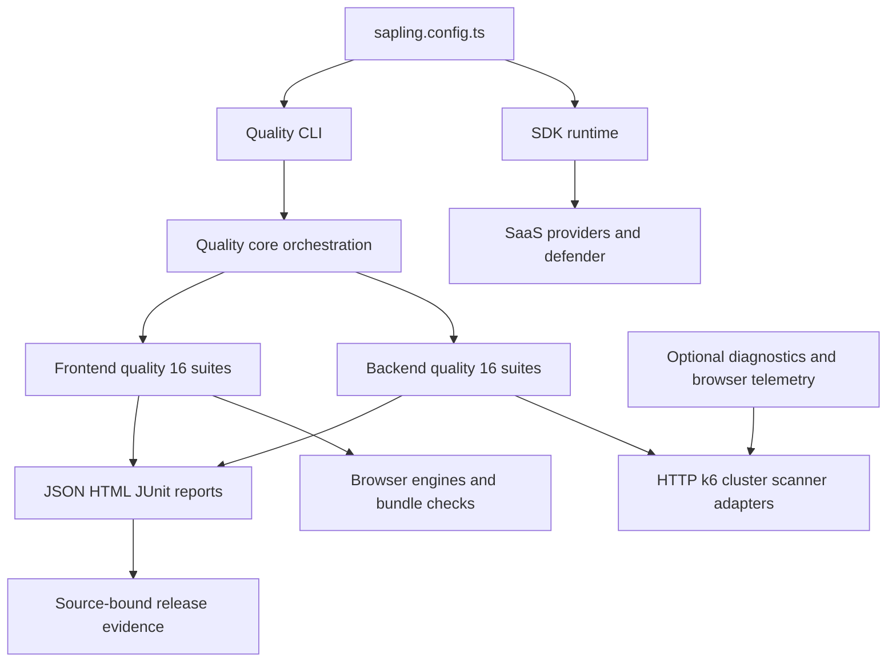

# Integrated quality architecture and lifecycle

## Low-level flow

1. CLI loads trusted TS/JS/JSON config, unwraps the quality section, validates routes and profiles, and selects explicit scope/suite IDs.
2. Registry maps namespaced identifiers to backend/frontend adapters. The runner creates a unique report directory.
3. Safety guard denies unapproved targets and disruptive tests. Adapter executes bounded subprocesses or HTTP/browser actions, collects metrics and checks, and returns a typed result.
4. Errors and unavailable prerequisites are failed/skipped, never green. Dry run is explicitly skipped and is not evidence of execution.
5. Reporter emits JSON, HTML and JUnit. Release gate requires current source-bound evidence separately; local reports do not satisfy live gates.

Runtime SDK dependency graph contains catalog, security and lightweight quality contracts only. Optional instrumentation packages have no browser/load testing engines. Quality CLI, core and both engine packages are development tooling. See original backend and frontend PRD/HLD/LLD under this directory for detailed requirements.
