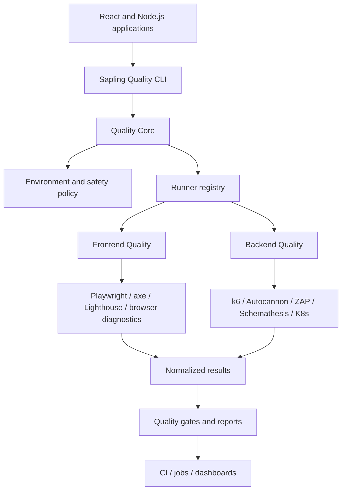

> Historical standalone Quality Platform baseline (v0.1.0). See ../QUALITY_INTEGRATION.md for current commands and validation.

# Sapling Quality Platform

**One TypeScript monorepo. One quality CLI. Separate frontend/backend suites. Shared policy, execution, and reporting.**

> Implementation snapshot — 2026-11-09. The monorepo is an **integration-oriented starter**, not a claimed security-certified or fully validated production system. The runner includes actual adapters and quality checks across the agreed categories. Several sophisticated scenarios require application-specific fixtures, deployment credentials, and installed third-party engines. See [IMPLEMENTATION_MATRIX.md](IMPLEMENTATION_MATRIX.md) and [docs/IMPROVEMENTS.md](docs/IMPROVEMENTS.md) before rollout.

## Packages

| Package | Purpose |
|---|---|
| `@sapling/quality-core` | Config loading, typed contracts, policies, subprocess runner, orchestration, thresholds, JSON/HTML/JUnit reports |
| `@sapling/backend-quality` | 16 backend categories, k6, Autocannon, OpenAPI/security, Toxiproxy, Node diagnostics, K8s/chaos integration |
| `@sapling/frontend-quality` | 16 frontend categories, Playwright, axe-core, screenshots, browser metrics, gzip bundle budget, React Profiler, Web Vitals |
| `@sapling/quality-cli` | Unified command line (`sapling-quality list / doctor / run`) |
| `apps/api` | Sample Express API: health, readiness, Prometheus metrics, idempotent order endpoint |
| `apps/web` | Sample React/Vite app: responsive views, navigation, browser telemetry and React profiling |

**Intended targets:** Node.js 22+, TypeScript, React, Express, Docker, Kubernetes. Playwright browsers and native tools are installed separately.

## Quick start

```bash
pnpm install --no-frozen-lockfile
pnpm run build
pnpm exec playwright install chromium
# Shell 1
pnpm run dev:api
# Shell 2
pnpm run dev:web
# Shell 3
pnpm run build:web
pnpm run quality -- list
pnpm run quality -- doctor
pnpm run quality -- run --config sapling.quality.config.ts --profile pr
```

For a minimal demonstration that does not require an external native load tool:

```bash
pnpm run quality -- run --suite backend:performance,backend:concurrency,backend:observability --scope backend
pnpm run quality -- run --suite frontend:accessibility,frontend:responsive --scope frontend
```

Playwright needs its browser binaries; `pnpm exec playwright install --with-deps chromium firefox webkit` may require OS prerequisites. For native engines such as k6, `st` (Schemathesis), `semgrep`, `zap.sh`, `kubectl` and Chaos Mesh, install the tools in the runner environment first.

**Visual baselines** require explicit approval:

```bash
pnpm run quality -- run --suite frontend:visual --update-baselines
# Review and commit quality-baselines/
pnpm run quality -- run --suite frontend:visual
```

### Config and schedules

`sapling.quality.config.ts` is the example unified config. Built-in profiles: `pr`, `main`, `nightly`, `release`; `--suite` overrides them, `--scope frontend|backend|fullstack` filters. A custom project should copy this config and tailor URLs, routes, thresholds, security headers, idempotency assertions, browser support and load models.

`run --dry-run` enumerates suites and reports them as skipped (by design, no testing occurred). It exits successfully in dry-run mode.

### Safety policy

- All remote hostnames must appear in `allowedHosts` (localhost is allowed).
- Production target is disabled unless expressly enabled; **destructive experiments can never target `environment: production`**.
- Kubernetes chaos, recovery, scaling/fault suites require both `safety.allowDestructive=true` and the `--allow-destructive` CLI flag, as well as a dedicated namespace.
- Kubernetes RBAC defaults to **read-only**. Separate tightly scoped role bindings and approvals are needed for mutations.
- Native engine failures and missing prerequisites result in a failed run; configured-but-unsupported suites report `skipped`, and the CLI fails closed on skips, rather than silently claiming a complete green suite.
- Do not point load/fault/scan experiments at production or third-party systems without authorization.

### Outputs

Each execution creates `quality-results/<timestamp-and-id>/` with:

- `report.json` — machine-readable suite status, measurements and checks
- `report.html` — readable summary
- `junit.xml` — CI integration
- Additional generated scripts, screenshots, screenshot diffs and engine summaries when supported

### Architecture overview



## Documentation

- [Architecture and component boundaries](docs/architecture/PLATFORM_HLD.md)
- [Core low-level design](docs/architecture/CORE_LLD.md)
- [Backend PRD](docs/backend/PRD.md), [HLD](docs/backend/HLD.md), [LLD](docs/backend/LLD.md), [Getting Started](docs/backend/GETTING_STARTED.md)
- [Frontend PRD](docs/frontend/PRD.md), [HLD](docs/frontend/HLD.md), [LLD](docs/frontend/LLD.md), [Getting Started](docs/frontend/GETTING_STARTED.md)
- [Deployment guide](docs/operations/DEPLOYMENT.md), [Runbook](docs/operations/RUNBOOK.md), [Security model](docs/operations/SECURITY.md)
- [Tool choices and licenses](docs/TOOL_MATRIX.md)
- [Capability matrix](IMPLEMENTATION_MATRIX.md)
- [Gaps and improvement plan](docs/IMPROVEMENTS.md)
- [Contributing](CONTRIBUTING.md)

## Delivery boundaries

No project test-case suites have been authored, per scope. **The code itself has not been fully integration-tested**: the assembly environment could not reach npm registry to install dependencies. A local TypeScript *syntax* scan was performed, but dependency resolution and `pnpm run build` must run in a connected environment. No browser/cluster/chaos result is asserted in this distribution. The referenced CI workflows are example configurations to be adapted, not evidence of successful CI.
