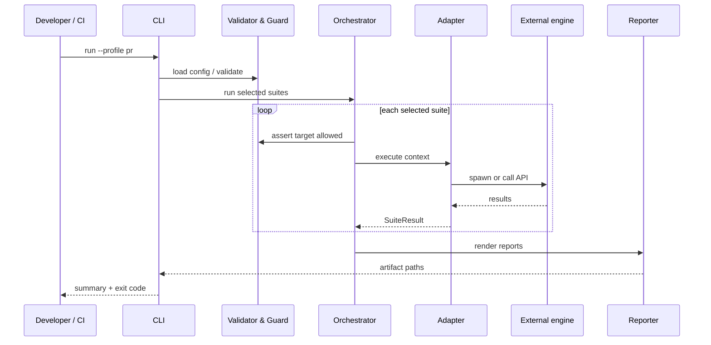

# Sapling Quality — Core Low-Level Design

## Key interfaces

```ts
interface SuiteRunner {
  (context: RunContext): Promise<SuiteResult>;
}
interface SuiteResult {
  suite: SuiteId;
  status: 'passed' | 'failed' | 'skipped';
  engine: string;
  summary: string;
  startedAt: string;
  finishedAt: string;
  durationMs: number;
  metrics?: Record<string, Metric>;
  checks?: CheckResult[];
  stdout?: string;
  stderr?: string;
  artifacts?: string[];
}
```

## Source-level modules

- `types.ts` — const suite identifiers, project config, endpoint and workload definitions, checked outcomes.
- `validation.ts` — minimal config shape assertions; schema-based deep validation is a future enhancement.
- `guard.ts` — URL allowlist, production restrictions, required destructive approvals, VU cap.
- `exec.ts` — `spawn` with `shell:false`, inherited environment, timeout and bounded output capture.
- `results.ts` — common result construction, numeric metrics and threshold evaluation.
- `orchestrator.ts` — suite registration/lookup and sequential invocation, exception isolation, report aggregation.
- `reports.ts` — reports generated as JSON, HTML (escaped data), and JUnit XML (escaped output).
- `config.ts` — imports TS via Jiti, JS via native import, JSON via parser.

## Sequence



## Registry and profiles

Suite identifiers use `backend:<category>` and `frontend:<category>`. The orchestrator does not need to know what k6, axe, kubectl or Playwright do. An adapter is a function registered under its suite ID. Profiles select a subset per PR/main/nightly/release. A missing selected runner yields a failure, not an implicit success.

## Extending the system

```ts
quality.register('backend:load', async context => {
  // Call an engine using execFileSafe, parse real results,
  // return result('backend:load', 'engine-name', start, ...).
});
```

Use `assertTargetAllowed` for custom target URLs and the supplied `runExternal` / `execFileSafe` for native commands. Do not interpolate command strings into a shell. Store artifacts in `ctx.outputDir` and redact secrets before including logs in reports.

## Known tradeoffs

- Sequential execution favors safe, legible MVP operation over high throughput.
- No historical index: report retention and comparison belong to a follow-on service.
- No distributed semaphore or queue: scheduled jobs must use Kubernetes concurrency controls.
- Thresholds are basic maximum/minimum numeric checks; trend-based baseline comparisons require additional storage.
- Dynamic TS config can execute code; only load files from trusted repositories.
