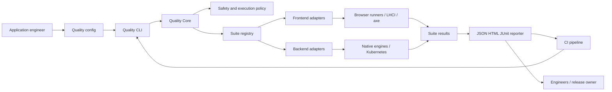
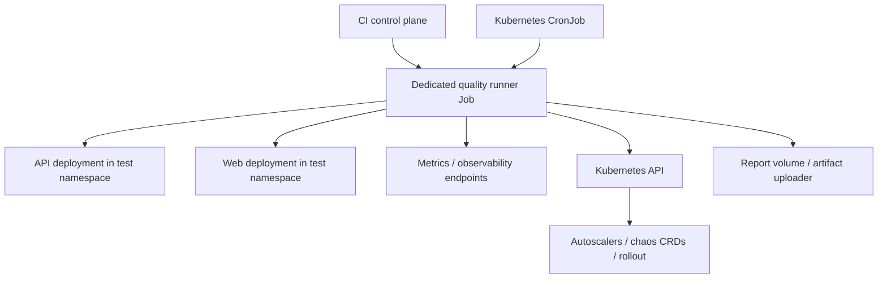

# Sapling Quality — Platform High-Level Design

## Objective and boundaries

A reusable, TypeScript-first, single-repository quality platform for browser/React and Node.js/API applications deployed in Docker/Kubernetes. Runtime testing is **not bundled into production-serving containers**. Each app receives a config file; dedicated runners execute tests against isolated target environments.

## System context

## Component responsibilities

| Component | Responsibility | Does not own |
|---|---|---|
| Core | Configuration, policy, registry, result normalization, reports | Browser-specific and API-specific logic |
| Frontend | Browser capability adapters and React/browser instrumentation | Kubernetes workload mutation |
| Backend | HTTP load generation, service fault injection and cluster read/write adapters | Browser screenshot management |
| CLI | Argument parsing, profiles, execution and exit status | Native engine implementation |
| Infra | Kubernetes runner manifests, Helm chart, sample deployments, Docker images | Secrets / cluster provisioning |
| Example apps | Educational integration targets | Real business workflows |

## Data and control flow

1. Load TS/JSON config via `loadQualityConfig`.
2. Validate target URLs and permitted suites; `--scope` and profiles select suites.
3. The orchestrator runs each registered suite sequentially, checking remote allowlists and destructive controls before launch.
4. Each adapter generates workload inputs or calls a tool using a no-shell spawn, including timeout and captured output.
5. Structured results contain IDs, start/end times, status, measurements, assertions and file paths.
6. Reports are created locally and uploaded by CI or retained via Kubernetes volumes/object storage integrations.

## Deployment topology

**Trust boundaries:** Runner privileges differ per category; ordinary browser tests should not possess cluster mutation access. Chaos and rollout require short-lived elevated credentials in a dedicated test cluster and namespace, plus explicit flags. Production disaster-recovery operations are out of scope for automatic mutation.

## Nonfunctional requirements

- Determinism: seeded application state, reviewed baselines, stable targets, repeatable build IDs.
- Observability: engine stdout/stderr, normalized metrics, correlation with runtime telemetry.
- Safety: host allowlist, maximum VUs, timeouts, non-production-only destructive operations, cleanup in `finally`.
- Extensibility: new suite registers `SuiteRunner(ctx) -> SuiteResult`, no changes required in core reporting.
- Operability: CLI reports status to CI via exit code, JUnit and HTML artifacts.
- Scalability: current in-process sequential suite orchestration is a baseline; coordinator/worker distribution is future work.

## Failure handling

Missing required external engines must be visible as failed or skipped (not green), failing the CLI exit code. Cleanup of injected toxic resources and Chaos Mesh CRs is mandatory where feasible, but operator intervention may still be necessary after abnormal runner termination.
