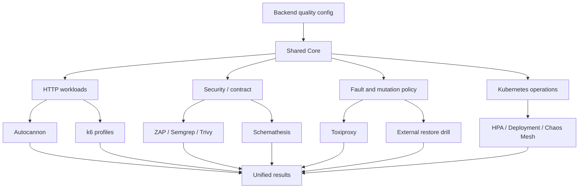
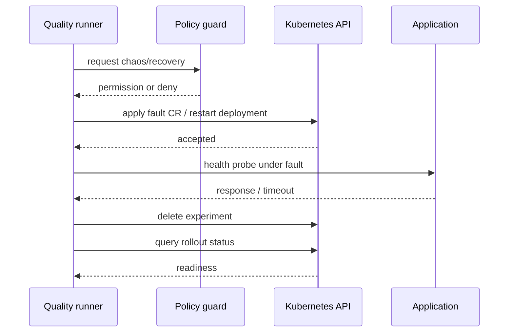

# Backend Quality — High-Level Design

## Technology map

## Logical components

1. **Workload builder:** emits k6 JavaScript scripts from typed endpoint models and load/stress/spike/soak/staged profiles. The generated workload captures HTTP request checks and metrics under SLO thresholds.
2. **Benchmark adapter:** invokes Autocannon programmatically and normalizes latency percentile, throughput and errors.
3. **Dependency fault adapter:** talks to Toxiproxy's HTTP API, injects latency and cleans toxic resources in `finally`.
4. **Security/contract adapters:** invoke Semgrep/Trivy/ZAP/Schemathesis installed in trusted runners, using explicit file plans.
5. **Kubernetes adapter:** uses restricted kubectl context/namespace; audits Deployment, HPA, PDB and probes; controlled rollout restart.
6. **Chaos adapter:** applies a provided Chaos Mesh CR; checks endpoint and deletes the CR when finished.
7. **Diagnostics SDK:** optional Node.js process metrics helper: event-loop delay, CPU and heap; sample Express API exposes Prometheus text format.

## Kubernetes interaction

## Boundary conditions

- k6 targets external URLs on an explicit allowlist; it runs as a separate process, **not as TypeScript code imported into Node.js**.
- Kubernetes namespace is scoped and read from config; a context may be set explicitly.
- App-specific availability, semantic data correctness and RTO/RPO must be asserted by owners; the package does not infer application invariants automatically.
- The runner is deployment infrastructure; production application images must not embed security scanners and browser engines.
