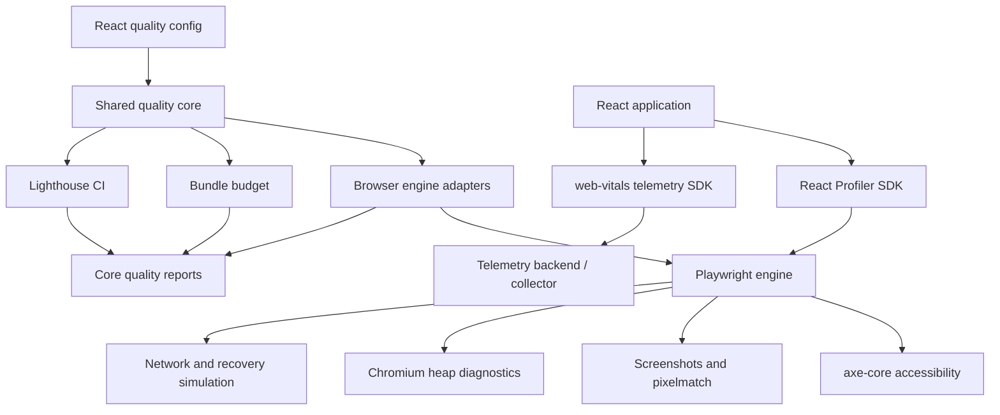

# Frontend Quality — High-Level Design

## Reference architecture

## Execution topology

Browser checks run from test containers against the deployed React application URL. A browser process may spawn multiple contexts, each with configured viewport and route. Test-browser binaries and browser launch libraries are in the **quality runner image**, not in the frontend application container. The app may include lightweight instrumentation with React Profiler wrappers and the `web-vitals` library.

## Primary paths

1. Page audits: Playwright launches one or all browsers, navigates routes, reports document HTTP response, JS errors and specific category checks.
2. Visual: screenshots saved to the run directory, compared with an approved baseline. Missing baselines fail until explicitly updated.
3. Accessibility: axe-core evaluates DOM accessibility rules in each target page; results normalized to counts/checks.
4. Performance: browser Navigation Timing / buffered LCP and long tasks, or LHCI when configured. Field diagnostics are separate browser-side telemetry events.
5. Network resilience: Playwright request interception and offline emulation; application fallback assertions are optional explicit selectors.
6. React rendering: a `SaplingProfiler` wrapper appends measured React commits to a bounded window buffer readable by Playwright.

## Component boundaries

| Component | Owns | Important caveat |
|---|---|---|
| Playwright | Browser lifecycle, navigation, screenshot, route mocking, console/page errors | Must install browsers separately |
| axe-core | Automated accessibility rule violations | Manual accessibility checks still needed |
| pixelmatch | Pixel-difference ratio | Anti-aliasing and dynamic data require deterministic fixtures |
| Lighthouse CI | Lab Lighthouse assertions when configured | Lab metrics are not population field metrics |
| React SDK | Profiler samples | Only wrapped subtrees are measured |
| web-vitals SDK | LCP, CLS, INP events from real browsers | Needs telemetry ingestion and sampling policy |
| Core | Execution policies, threshold/result normalization | No framework knowledge |

## Threat and trust boundaries

Avoid storing cookies, tokens or user data in screenshots, traces or logs. Use synthetic accounts and clean data. Running Playwright in privileged containers or sharing a browser context between unrelated tenants is out of scope. Route blocking should never interfere with production traffic; it operates within a controlled test browser context.
