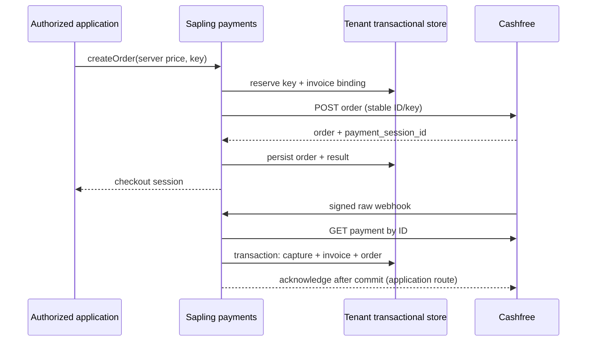

# Cashfree payment gateway — v0.11.0

## Decision and scope

Cashfree is the preferred **default payment-gateway selector** for new applications. It is not automatically connected to a merchant account. Configure credentials and a trusted customer resolver, or inject an explicit adapter. An unconfigured or disabled gateway rejects payment operations. Existing named injected adapters remain selected if no provider is explicitly chosen. Razorpay and Stripe remain selectable; `custom` remains an explicit adapter extension point. No automatic failover between financial providers.

This release implements Cashfree Payment Gateway INR checkout (minimum ₹1; integer paise input), captured payment reconciliation, order recovery and refund creation/polling. It does **not** implement Cashfree Subscriptions, mandates, saved payment instruments, payouts, disputes or settlement accounting. The existing Stripe recurring/tokenized-method adapters remain separate, and a basic Stripe PaymentIntent adapter is added. Razorpay's existing signed capture/refund webhook path is retained. Cashfree refund webhooks and automated polling scheduler, Stripe one-time webhook/refund polling, production PCI/finance policy and live sandbox evidence remain open.

## Typed configuration

```ts
import { defineSaplingConfig } from '@saplings/sdk';
// `store` is the application's persistent tenant-scoped store; read env via secret manager.
export default defineSaplingConfig({
  app: { id: 'billing-app', environment: 'development' },
  payments: {
    provider: 'cashfree', // default if no explicit/injected gateway
    cashfree: {
      clientId: process.env.CASHFREE_CLIENT_ID!,
      clientSecret: process.env.CASHFREE_CLIENT_SECRET!,
      environment: 'sandbox',
      apiVersion: '2025-01-01',
      // Never trust phone/email/tenant from arbitrary client body.
      customer: async ({ tenantId, reference }) => {
        const c = await store.get<{id:string;phone:string;email?:string}>(
          tenantId, 'checkout-customers', reference);
        if (!c) throw new Error('Unknown approved checkout customer');
        return c;
      },
      notifyUrl: 'https://your-app.example/webhooks/cashfree',
      returnUrl: 'https://your-app.example/checkout/result',
    },
  },
  providers: { store },
});
```

Production requires explicit `environment: 'production'` for the built-in Cashfree configuration, a transactional persistent store and the existing production SDK security requirements. Sandbox is the default Cashfree environment. API version is pinned to 2025-01-01, with 2026-01-01 opt-in; validate the selected version against the merchant account. Merchant-specific restrictions must be verified. Only INR with two decimal places is supported by the new Cashfree adapter. `clientSecret` and checkout session IDs are sensitive, never log or expose them to unrelated users. `PaymentResult` exposes the checkout session to the authorized checkout client; storage encryption and field-level access for persisted result records remain deployment requirements.

### Alternatives

```ts
payments: { provider: 'razorpay', razorpay: {
  keyId: process.env.RAZORPAY_KEY_ID!, secret: process.env.RAZORPAY_KEY_SECRET!,
  webhookSecret: process.env.RAZORPAY_WEBHOOK_SECRET!,
} }
// OR
payments: { provider: 'stripe', stripe: { secret: process.env.STRIPE_SECRET_KEY! } }
```

With Stripe, `createOrder` returns a PaymentIntent client secret; use Stripe.js in the authorized checkout application, and reconcile via a server-side read. Existing StripeRecurringGateway and StripeRecurringWebhook are configured independently through `services.recurring`. No automatic mapping of Stripe mandates to Cashfree. Razorpay `SAAS-050` is wired automatically only when a webhook secret is present in the Razorpay settings, or explicitly configured via the legacy capability adapter.

## SDK operations

```ts
const sapling = createSapling(config);
// Trusted server context with payments:write, never a client-created context.
const request = { amountMinor: 1034, currency: 'INR', reference: 'invoice-42',
  invoiceId: 'invoice-42', idempotencyKey: 'checkout-42' };
const order = await sapling.payments.createOrder(ctx, request);
// Send order.checkoutSessionId only to the verified checkout owner.
// If createOrder times out, do not create a new key. Read the provider order instead:
const recovered = await sapling.payments.recoverOrder(ctx, request);
// Once an actual provider payment ID is available, use trusted server reconciliation:
await sapling.payments.reconcilePayment(ctx, { orderId: order.id, paymentId: verifiedProviderPaymentId });
const refund = { paymentId: verifiedProviderPaymentId, amountMinor: 500, idempotencyKey: 'refund-42' };
await sapling.payments.refund(ctx, refund);
await sapling.payments.reconcileRefund(ctx, refund);
```

Permissions: `payments:write` for order/recovery, `payments:reconcile` for explicit capture polling, `payments:refund` for refund/reconciliation. Generic capability access additionally needs `capabilities:SAAS-042:order`, `capabilities:SAAS-047:refund` or `capabilities:SAAS-050:reconcile`. Tenant context is a trusted server-created identity; direct calls deny impersonation and frozen tenants. The application must enforce invoice ownership and resource-level permissions before creating a checkout; no API accepts client-supplied prices as trusted.

## Technical flow and state

1. Transactionally reserve the tenant-local `payment-requests` key with provider, amount, currency, reference and invoice binding. Repeating the same completed request returns the prior result; changed arguments or gateway conflict. Pending requests require explicit recovery.
2. Cashfree uses a deterministic merchant order ID and UUID-shaped idempotency header. Send authenticated POST `/pg/orders` using amount in rupees; validate response amount, currency, order ID and status. Record `payment-orders` and the request result atomically with audit.
3. Serve the hosted checkout session only to the authorized user. A created order or frontend redirect is never payment confirmation. On timeout, `recoverOrder` uses GET by deterministic order ID. A 404 is not permission to create another order automatically; operators must reconcile according to provider idempotency retention and account records.
4. A signed Cashfree `PAYMENT_SUCCESS_WEBHOOK` uses timestamp concatenated with the exact raw body and HMAC-SHA256/Base64. Only after verification, resolve IDs and fetch `/pg/orders/{order_id}/payments/{cf_payment_id}`. Require success, capture flag, matching amount/currency/order/payment, tenant-owned record, and atomically update invoice + verified payment + order. Duplicate capture returns a duplicate outcome. Other Cashfree webhook types are not processed by the reference handler; use refund polling and add event-specific processing before production.
5. Refund reserves amount against verified captured balance. Cashfree POST `/pg/orders/{order_id}/refunds` uses deterministic refund ID and idempotency header. GET refund by that ID reconciles pending/ambiguous state. Successful refunds increment `refundedMinor`; failed/cancelled refunds release reservation. Terminal results cannot increment twice. Refunds to a different provider are rejected.
6. Provider account identity and secret rotation are operator-managed in v0.11.0. Do not migrate open orders by changing `provider`; drain/reconcile them through the original account. Older untagged records are treated as legacy Razorpay; audit and explicitly migrate custom legacy records. No automatic cross-gateway refund.



## Webhook route contract

Mount a dedicated bounded raw-body route before JSON parsing, enforce TLS, and use an independently verified merchant-to-tenant routing mechanism. `CashfreeWebhookAdapter` verifies raw string or byte sequence using Cashfree secret; generic `SAAS-050` accepts `rawBody` as original UTF-8 text, `timestamp` as header string and `signature` as header string. Reject missing/duplicate headers, invalid UTF-8 and oversized requests before invocation. Application callback route owns response codes, authentication model, rate controls, mapping and redaction. A successful response must only follow durable reconciliation; failure should be retried/reviewed per provider rules. Timestamp max age defaults to 24 hours, configurable 1 second–7 days; set it to a reviewed provider redelivery window. Reject future skew/out-of-window timestamps, use stable payment ID for duplicate protection. If provider delays success beyond the window, recover by polling rather than bypassing signature checking.

## Code and test evidence

- `packages/sdk/src/cashfree.ts`: transport, validation, webhook, reconciliation.
- `packages/sdk/src/integrations.ts`: transaction-safe service routing and refund state.
- `packages/sdk/src/stripe-payment.ts`: basic Stripe one-time adapter.
- `packages/sdk/src/razorpay-webhook.ts`: legacy capture/refund; provider ownership check.
- `tests/v011.test.mjs`: local mocked HTTP regressions (not a live payment test).
- `docs/features/saas/SAAS-042`, `SAAS-047`, `SAAS-050`: product, technical and detailed gap specs.

## Production gates

- Run hosted checkout in Cashfree sandbox using real test merchant credentials. Verify success, failure, abandoned checkout, timeout/recovery, tampered and repeated webhook, invoice ownership, concurrent refunds, and partial/full/failure settlement. Use a persistent database and multiple replicas. Validate both API versions if supported by product.
- Add merchant-account binding, complete customer authorization/one active checkout per invoice, encrypt sensitive results at rest, reconciliation worker with bounded queue and operator recovery, refund webhook event types, settlement/dispute accounting, Cashfree subscription mandates and jurisdiction-specific tax policy as applicable.
- Keep Stripe and Razorpay sandbox validation separate. Stripe one-time refund polling/webhook and ambiguous-operation recovery remain incomplete; do not claim parity across gateways.
- Obtain finance, security, privacy and operations review. No live provider calls or financial transactions were performed during this build.

## Official API references (consulted for implementation)

- https://www.cashfree.com/docs/api-reference/payments/latest/orders/create-order
- https://www.cashfree.com/docs/api-reference/payments/latest/payments/get-payment-by-id
- https://www.cashfree.com/docs/api-reference/payments/latest/refunds/create-refund
- https://www.cashfree.com/docs/api-reference/payments/latest/refunds/get-refund
- https://www.cashfree.com/docs/payments/online/webhooks/signature-verification
