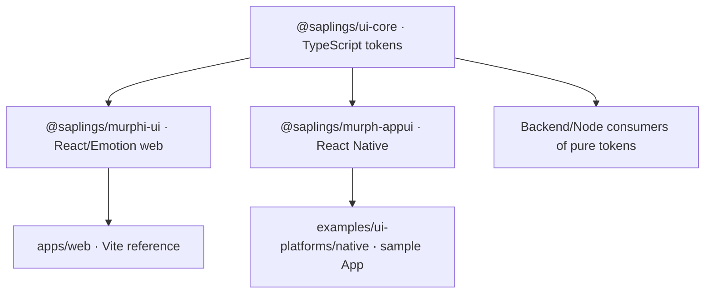

# Murphi UI — Technical Specification (v0.14.0)

## Package dependency architecture



The **SDK backend does not import either React UI package**. The shared tokens contain no React imports and may be consumed from either platform. React 18.3/19 web peers; RN 0.88 / React 19.3 native peers. A real installed-workspace build must validate React Native's resolved peer version before publishing.

## Source inputs

- `murphui.zip`: `src/components/*` (39 directories, original React/Emotion implementations) migrated to `packages/murphi-ui/src/components/*`; `src/theme/{colors,palette,typography,spacing,breakpoints,types}.ts` moved to `@saplings/ui-core`, and web `theme/*` now re-exports core instead of maintaining a second palette.
- `xlox-ui-main.zip`: package structure and `core/components/lib/icons/stories` organization applied to all three packages. No Xlox component code directly copied; original Xlox source contains a single Bold component implementation and full MIT license.
- Source provenance, missing Murphi license notice and rights verification appear in `PROVENANCE.md`.

## Shared tokens (`@saplings/ui-core`)

`createTheme(mode, overrides)` returns the Murphi-compatible `XloxTheme` shape with `colors`, `typography`, `spacing`, `breakpoints`, `shadows`, `shape`, `direction`, and `density`. `lightPalette`/`darkPalette` and all `colors` are derived from the uploaded files. Available helpers: `spacingPx`, `toNativeTypography`, `getSemanticColors`, `cssVariables`, `cssVariableText`, `currentBreakpoint`, `resolveResponsive`. Numeric spacing is 8 units of CSS px / native density-independent pixels per factor, multiplied by 0.75 in compact mode. Legacy `spacing(factor)` returns a CSS string; native never renders this value directly.

Color overrides accept six-digit hex strings only. Themed SSR output has no browser globals; CSS-variable serialization validates selectors. The shared package is pure ESM with NodeNext declarations and no runtime peers. Web and mobile each supply a theme-provider context.

## Web (`@saplings/murphi-ui`)

- `src/components` is the uploaded Murphi React/Emotion library (component implementation source), refactored for TypeScript NodeNext `.js` module paths and common design tokens. `theme-provider.tsx` supplies `MurphiThemeProvider`, `useTheme`, and `XloxThemeProvider` alias (backwards compatibility).
- `src/core` re-exports `ui-core`, `src/lib` uses Murphi class and responsive helpers, `src/icons` accepts icon slots without embedding font assets, `src/stories` reserved for Storybook examples. `components/index.ts` re-exports the source components, including `ToastProvider/useToast` (not a standalone `Toast` export).
- The original Button's styling-only properties are not forwarded to HTML attributes. Input and Button use the shared theme typography font family.
- `@emotion/react`, `@emotion/styled` are web package dependencies; React and React DOM are peers. Web renders SSR without needing document for components that are not mounted portals. Dialog and overlay focus/scroll behavior require browser tests.

## Native (`@saplings/murph-appui`)

- `src/core/theme.tsx` uses React context plus native `useColorScheme()` for system light/dark selection and `createTheme()` from ui-core.
- `src/components/{primitives,forms,feedback,disclosure,extras}.tsx` implement native screen primitives, form components, accessible state and labels, modal/selection overlays, alerts, progress, text and list/table patterns. Native `Slider` intentionally omitted: use a supported `@react-native-community/slider` integration or a11y-verified custom implementation rather than a pretend native slider.
- Native platform uses `Pressable`/`onPress`, `TextInput`/`onChangeText`, `View`/`Text` and numeric StyleSheet-compatible values. No DOM/Emotion imports, no CSS strings. Mobile `Select`, Tooltip, Drawer and Toast are native approximations; parity tests must account for semantics and modality rather than DOM equivalence.
- Metro can consume TypeScript source through the `react-native` export condition, while `dist` supplies emitted declarations and ESM for package tooling. Verify Metro module resolution and duplicate React installations in the host application.

## Examples

```tsx
// Web
import {MurphiThemeProvider,Button,Card,Typography} from '@saplings/murphi-ui';
export function WebHome(){return <MurphiThemeProvider><Card><Typography variant="h5">School</Typography><Button onClick={()=>{}}>Open</Button></Card></MurphiThemeProvider>}
```

```tsx
// React Native
import {MurphAppThemeProvider,Button,Card,Typography} from '@saplings/murph-appui';
export default function MobileHome(){return <MurphAppThemeProvider><Card><Typography variant="h5">School</Typography><Button onPress={()=>{}}>Open</Button></Card></MurphAppThemeProvider>}
```

## Build/testing

```bash
corepack enable
corepack prepare pnpm@10.11.0 --activate
pnpm install --frozen-lockfile # requires a reviewed, committed pnpm-lock.yaml
pnpm run build:ui-core
pnpm run build:murphi-ui
pnpm run build:murph-appui
pnpm run typecheck:ui
pnpm run test:ui
pnpm --filter @sapling/example-web run build
```

Offline testing in this build uses global TypeScript and a subset of React/Emotion modules included in the uploaded Murphi demo **only for local tests**. No vendored `node_modules` enter the archive. The native structural typecheck uses an explicitly labeled local shim when RN itself is unavailable; this does not replace compiling against actual React Native 0.88 definitions or simulator tests. See `../evidence/` for results and release blockers.
